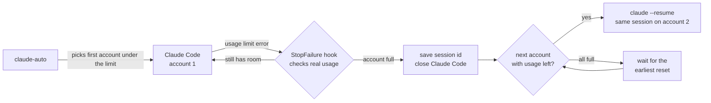

<!--
Developed by Mohammad Rameez Imdad (Rameez Scripts)
WhatsApp: https://wa.me/923435347417 (For Custom Projects)
YouTube: https://www.youtube.com/@rameezimdad (Subscribe for more!)
-->

<h1 align="center">Claude Code Usage Limit Reached? Auto Switch to Your Next Claude Account</h1>

<p align="center">
  <b>claude-auto</b> is a free, open-source <b>Claude account switcher</b> for <b>Claude Code</b>.<br>
  When one account hits its <b>5-hour or weekly limit</b>, the <b>same session</b> continues on your next Claude account that still has usage left.
</p>

<p align="center">
  <a href="https://github.com/rameezimdad/claude-auto-switch/stargazers"></a>
  
  
  
  <a href="LICENSE"></a>
</p>

<p align="center">
  <a href="#quick-start">Quick start</a> &middot;
  <a href="#how-it-works">How it works</a> &middot;
  <a href="#commands">Commands</a> &middot;
  <a href="#faq">FAQ</a> &middot;
  <a href="#other-languages">Other languages</a>
</p>

---

## The problem

You are in the middle of a task in Claude Code and this appears:

```
Claude usage limit reached. Your limit will reset at 5:00 PM.
```

The session stops. You open a second account, start a new chat, explain the task again, and lose time and context.

## The fix

```
$ claude-auto
claude-auto: checking accounts...
  account 1 (~/.claude): 41% used
claude-auto: using account 1 (~/.claude)

  ... you work for hours, the limit hits ...

claude-auto: account 1 (~/.claude) hit its usage limit. Switching...
  ~/.claude-2: 12% used
claude-auto: using ~/.claude-2
```

Claude Code reopens **the same conversation** on account 2 and continues the task where it stopped. You don't need to copy context or start a new chat.

## Features

| | |
|---|---|
| **Automatic account switching** | Moves to the next Claude account as soon as the usage limit is reached |
| **Checks usage first** | Reads each account's real 5-hour and weekly usage before it switches |
| **Same session, full context** | Resumes the same session ID, so the new account sees the whole conversation |
| **Continues, never restarts** | Checks what is already done in your code and picks up at the next unfinished step |
| **No false switches** | Ignores short 429 bursts while your plan still has room |
| **Waits for reset** | If every account is full, waits for the earliest reset, then continues |
| **Usage dashboard** | `claude-auto status` shows % used and reset time for every account |
| **Shared setup** | Every account shares history, settings, skills, plugins and CLAUDE.md |
| **Official hooks only** | Uses Claude Code's `StopFailure` hook. Nothing in Claude Code is patched. |
| **Any number of accounts** | 2, 3 or more Claude Pro / Max accounts |
| **Cross-platform** | Linux, Windows (WSL) and macOS |

## Quick start

**1. Install** (needs Claude Code, `bash`, `python3`, `curl`)

```bash
curl -fsSL https://raw.githubusercontent.com/rameezimdad/claude-auto-switch/main/install.sh | bash
```

**2. Add your other Claude subscriptions**

Your normal Claude Code login (`~/.claude`) is account 1. Add every extra subscription with one command:

```bash
claude-auto add
```

It creates the next free slot (`~/.claude-2`, then `~/.claude-3` ...), asks *"Log in to account 2 now?"*, and opens Claude Code there. Type `/login`, sign in with that subscription, then `/exit`.

Run it again for each subscription you own:

```bash
claude-auto add      # account 2
claude-auto add      # account 3
claude-auto add      # account 4
claude-auto add      # account 5, and so on, no limit
```

**3. Work as usual**

```bash
claude-auto
```

Every Claude Code flag works the same way, for example `claude-auto -c`, `claude-auto --resume <id>` or `claude-auto -p "..."`.

> Tip: add `alias claude=claude-auto` to your `~/.bashrc` or `~/.zshrc` so every session is protected.

## Managing your Claude subscriptions

| I want to... | Run |
|---|---|
| Add one more subscription | `claude-auto add` |
| Add account 4 / 5 / 6 by number | `claude-auto add 4` |
| See all accounts and their usage | `claude-auto status` |
| Log in again (token expired, new plan) | `claude-auto login 3` |
| Stop using one account | `claude-auto remove 3` |
| Change the order accounts are tried | Edit `~/.config/claude-auto/accounts`, one folder per line, top is tried first |

Every account you add shares the same conversation history, settings, skills, plugins, slash commands and `CLAUDE.md` as account 1. Only the login is separate, so a session can move to any of them and carry on.

## How it works



1. `claude-auto` checks the usage of each account in your list and starts Claude Code on the first one with room.
2. When a turn fails with a `rate_limit` error, the `StopFailure` hook asks that account's usage endpoint (the same data `/usage` shows) whether the plan is really full.
3. If it is full, the hook saves the session ID and closes Claude Code. If it isn't, nothing happens.
4. `claude-auto` checks the remaining accounts and reopens the same session on the first one with usage left. It brings along the session's edit checkpoints, todo list, plans and pasted images, and keeps your flags (`-p`, `--model`, permission mode).
5. Claude is told **not to start over**. It checks the real state of your code (git status / git diff or the files it was editing), skips the finished steps and continues from the next unfinished one.

Accounts that are not logged in are skipped. If an account's token has expired, it is tried last, because Claude Code refreshes the token on start.

## Commands

| Command | What it does |
|---|---|
| `claude-auto` | Start Claude Code with auto switching (all `claude` flags pass through) |
| `claude-auto status` | Usage % and reset time of every account |
| `claude-auto add` | Add the next Claude subscription (account 2, 3, 4 ...) and log it in |
| `claude-auto add <n>` | Add a specific slot, for example `claude-auto add 7` |
| `claude-auto login <n>` | Log in again or change the subscription on account `n` (`1` = `~/.claude`) |
| `claude-auto remove <n>` | Take account `n` out of the rotation (folder and login are kept) |
| `claude-auto accounts` | List accounts in the order they are tried |
| `claude-auto help` | Show help |

```
$ claude-auto status
account 1 (~/.claude)             97% used, resets Thu 17:00
~/.claude-2                        12% used, resets Thu 21:00
~/.claude-3                        not logged in
```

## Configuration

| Setting | Default | Meaning |
|---|---|---|
| `~/.config/claude-auto/accounts` | `~/.claude` + any `~/.claude-<n>` | One config folder per line, tried top to bottom |
| `CLAUDE_AUTO_MAX` | `95` | Treat an account as full at this % used, for example `CLAUDE_AUTO_MAX=90 claude-auto` |
| `CLAUDE_AUTO_MSG` | built-in | The message sent to the resumed session (default: check the current state, continue from the next unfinished step, never start over) |
| `CLAUDE_AUTO_HOME` | `~/.local/share/claude-auto` | Install folder |

## Platform support

| Platform | Status | Login is read from |
|---|---|---|
| Linux | Supported | `<config dir>/.credentials.json` |
| Windows (WSL) | Supported | `<config dir>/.credentials.json` |
| macOS | Supported | Keychain (`Claude Code-credentials`) |
| Windows (native PowerShell) | Not yet | Use WSL |

## Troubleshooting

| Problem | Fix |
|---|---|
| `claude-auto: command not found` | Add `export PATH="$HOME/.local/bin:$PATH"` to your shell profile |
| An account shows `not logged in` | Run `claude-auto login <n>`, then `/login` |
| An account shows `usage unknown` | The token expired or you are offline. It is still tried, and Claude Code refreshes the token on start. |
| No switch happened | Start with `claude-auto`, not `claude`. The hook only acts on sessions started by `claude-auto`. |
| The new account has no history | Create account folders with `claude-auto add` so `projects/` is shared. Otherwise the session is copied over. |

## Uninstall

```bash
bash ~/.local/share/claude-auto/uninstall.sh
```

This removes the scripts and the hook. Your account folders and logins are kept.

## FAQ

<details>
<summary><b>What to do when the Claude usage limit is reached in Claude Code?</b></summary>

Normally you wait for the reset, which can take up to 5 hours for the session window or longer for the weekly limit. With claude-auto, the session continues on another Claude account you own that still has usage left, without losing context.
</details>

<details>
<summary><b>How do I use Claude after reaching the limit?</b></summary>

Install claude-auto, add a second Claude account with `claude-auto add`, and start Claude Code with `claude-auto`. When the limit is reached, it switches for you.
</details>

<details>
<summary><b>How do I use multiple Claude accounts in Claude Code?</b></summary>

Run `claude-auto add` once for each extra subscription and log in when it asks. Each account gets its own config folder (`CLAUDE_CONFIG_DIR`) that shares your history and settings, and `claude-auto` picks the account with usage left.
</details>

<details>
<summary><b>How many Claude accounts can I add?</b></summary>

There is no limit. Run `claude-auto add` for account 4, 5, 6 and so on. They are tried in order, top to bottom.
</details>

<details>
<summary><b>How does the Claude usage limit work?</b></summary>

Claude Pro and Max plans have a rolling 5-hour session limit and a weekly limit. `claude-auto status` shows the % used and the reset time of both for every account.
</details>

<details>
<summary><b>Does switching lose my conversation or context?</b></summary>

No. The same session ID is resumed, so the new account loads the full conversation, including files, plans and tool results.
</details>

<details>
<summary><b>What happens when all my accounts reach the weekly limit?</b></summary>

claude-auto shows when the earliest account resets, waits until then and continues automatically.
</details>

<details>
<summary><b>Does it work with Claude Pro, Claude Max and API keys?</b></summary>

It works with any Claude subscription login (Pro, Max, Team). An account that uses an API key has no plan usage to check, so it is skipped.
</details>

<details>
<summary><b>Does it modify Claude Code?</b></summary>

No. It is a small bash wrapper plus one official `StopFailure` hook in `settings.json`. Plain `claude` sessions behave exactly as before.
</details>

<details>
<summary><b>Is it allowed to use several Claude accounts?</b></summary>

claude-auto only uses accounts you own and log into yourself. Read the Anthropic terms that apply to your plans before you use it.
</details>

## Other languages

**Japanese** - Claude Code の使用制限 (usage limit) に達したら、使用量が残っている次の Claude アカウントへ自動で切り替え、同じセッションのまま作業を続けます。

**Portuguese (BR)** - Atingiu o limite de uso do Claude Code? O claude-auto troca automaticamente para a próxima conta Claude com uso disponível e continua a mesma sessão.

**Spanish** - ¿Llegaste al límite de uso de Claude Code? claude-auto cambia automáticamente a tu siguiente cuenta de Claude con uso disponible y continúa la misma sesión.

**German** - Claude Code Nutzungslimit erreicht? claude-auto wechselt automatisch zum nächsten Claude-Konto mit freiem Kontingent und setzt dieselbe Sitzung fort.

**Vietnamese** - Hết giới hạn sử dụng Claude Code? claude-auto tự động chuyển sang tài khoản Claude tiếp theo còn lượt dùng và tiếp tục cùng phiên làm việc.

**Hindi** - Claude Code की usage limit खत्म हो गई? claude-auto अपने आप अगले Claude account पर switch करके वही session जारी रखता है।

**Urdu** - Claude Code ki usage limit khatam? claude-auto khud agle Claude account par switch kar ke wohi session jaari rakhta hai.

**Chinese** - Claude Code 达到使用限制?claude-auto 会自动切换到下一个仍有额度的 Claude 账号,并继续同一个会话。

**Russian** - Достигнут лимит использования Claude Code? claude-auto автоматически переключается на следующий аккаунт Claude с доступным лимитом и продолжает ту же сессию.

**Turkish** - Claude Code kullanım limitine mi ulaştınız? claude-auto, kullanım hakkı kalan bir sonraki Claude hesabına otomatik geçer ve aynı oturuma devam eder.

**Indonesian** - Batas penggunaan Claude Code tercapai? claude-auto otomatis berpindah ke akun Claude berikutnya yang masih punya kuota dan melanjutkan sesi yang sama.

**Arabic** - وصلت إلى حد استخدام Claude Code؟ ينتقل claude-auto تلقائيا إلى حساب Claude التالي الذي لا يزال لديه استخدام متاح ويكمل نفس الجلسة.

## Keywords

Claude Code usage limit, Claude limit reached, Claude usage limits, Claude weekly limit, Claude 5 hour limit, Claude multiple accounts, Claude account switcher, Claude auto switch, Claude multi account, Claude Code rate limit, Claude Pro limit, Claude Max limit, use Claude after reaching limit, Claude Code hooks, StopFailure hook.

## Author

Built by **Mohammad Rameez Imdad ([Rameez Scripts](https://rameezscripts.com))**. I make AI automation, ERP, CRM and Claude Code tools.

| | |
|---|---|
| YouTube | [@rameezimdad](https://www.youtube.com/@rameezimdad) |
| WhatsApp (custom projects) | [wa.me/923435347417](https://wa.me/923435347417) |
| Email | [Contact@rameezscripts.com](mailto:Contact@rameezscripts.com) |
| Website | [rameezscripts.com](https://rameezscripts.com) |

If claude-auto saved your session, **give it a star**. That helps other Claude Code users find it.

## License

[MIT](LICENSE) - free for personal and commercial use.

<sub>claude-auto is an independent open-source project and is not affiliated with or endorsed by Anthropic. Claude and Claude Code are trademarks of Anthropic.</sub>
